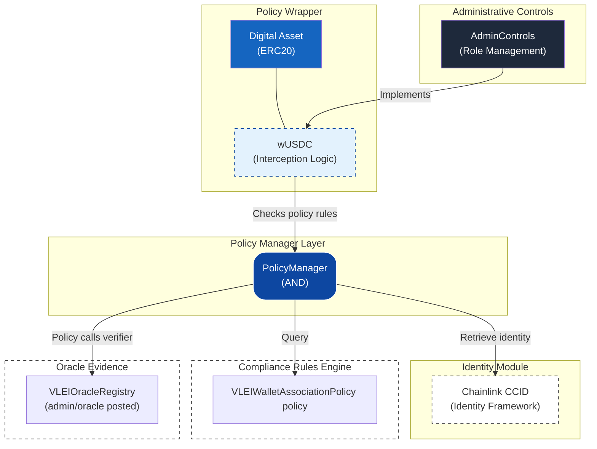

# USDC Compliance Integration

Generated by GL1 Compliance Wizard on 2026-05-06T16:48:52.598Z and extended with a vLEI oracle compliance path.

## Overview

This Foundry project implements a programmable compliance architecture for the **USDC** (ERC20) token.

## Prototype Maturity

This repository is a production-preparation prototype. It demonstrates the contract boundaries needed for vLEI Legal Entity compliance, but the current oracle path trusts admin/oracle-posted evidence and the local deployment script uses a dev-only `AllowAllPolicyEngine` for Chainlink registry writes. Do not treat the current Anvil deployment profile as production-ready.

Maintainer documentation:

| Document                                                                  | Purpose                                                              |
|---------------------------------------------------------------------------|----------------------------------------------------------------------|
| [Architecture](docs/architecture.md)                                      | Contract responsibilities and transfer evaluation flow               |
| [Identity and vLEI Model](docs/identity-and-vlei-model.md)                | Identity hints, exact-wallet endorsements, and AID-only rejection       |
| [Oracle Registry](docs/oracle-registry.md)                                | Wallet endorsement fields, authorization, and lifecycle     |
| [GL1 USDC CLI Execution Guide](docs/gl1-vlei-cli-execution-guide.md)      | Human-operated local originator-to-beneficiary workflow              |
| [GL1 USDC Local Infrastructure Setup](docs/gl1-vlei-local-infra-setup.md) | Local service startup, ports, generated artifacts, and cleanup       |
| [Security Model](docs/security-model.md)                                  | Trust boundaries, admin authority, and current limitations |
| [Contracts Reference](docs/contracts-reference.md)                        | Concise contract and interface map                                   |

## Architecture

The compliance framework follows a layered architecture aligned with the reference model (v1.0):



### Component Roles

| Component                   | Responsibility                                                                                        |
|-----------------------------|-------------------------------------------------------------------------------------------------------|
| **Policy Wrapper**          | Intercepts transfers, builds initial `TransactionEnvelope` with minimal context                       |
| **Policy Manager**          | **Orchestration Layer**: Performs dynamic identity enrichment on all parties before policy evaluation |
| **Identity Registry**       | **Single Source of Truth**: Provides enriched identity data (KYC, jurisdiction, credentials)          |
| **Compliance Rules Engine** | Evaluates policies against the **fully enriched** `TransactionEnvelope`                               |
| **Oracle Evidence**         | Stores the oracle’s exact wallet/entity/association result                             |
| **Administrative Controls** | Global system management, role-based access, and emergency pause                                      |

### Dynamic Identity Enrichment Flow

1. **Interception**: The token wrapper (`ERC20`, `ERC721`, or `ERC1155`) catches a transfer and creates a `TransactionEnvelope` containing basic party addresses and amount/TokenID.
2. **Orchestration**: The `PolicyManager` receives the envelope and iterates through every party.
3. **Enrichment**: For each party, the `PolicyManager` queries the `IGL1IdentityRegistry` for all configured identity fields (e.g., `kycHash`, `accountRef`).
4. **Evaluation**: Policies receive the **enriched** envelope, meaning they can immediately check `party.kycHash` or `party.jurisdiction` without making additional external calls.
5. **Attestation**: The vLEI policy passes enriched customer `PartyPacket` records to `VLEIEndorsementChecker`, which checks the current exact-wallet endorsement in `VLEIOracleRegistry`.

## Policies

- **VLEIWalletAssociationPolicy**: policy requiring both originator and beneficiary customer parties to have current exact-wallet endorsements.

## Project Structure

```
├── src/
│   ├── assets/
│   │   └── USDC.sol
│   ├── wrappers/
│   │   └── wUSDC.sol
│   ├── policies/
│   │   └── VLEIWalletAssociationPolicy.sol
│   ├── policy/
│   │   └── PolicyManager.sol
│   ├── admin/
│   │   └── AdminControls.sol
│   ├── identity/
│   │   └── [Framework contracts]
│   ├── attestation/
│   │   ├── VLEIOracleRegistry.sol
│   │   └── VLEIEndorsementChecker.sol
├── docs/
│   └── [Maintainer documentation]
│   └── interfaces/
├── lib/
│   └── chainlink-ccid/   (pre-included)
├── script/
│   └── DeployAll.s.sol
├── test/
├── setup.sh
├── foundry.toml
├── manifest.json
└── README.md
```

## Getting Started

### Prerequisites

- [Foundry](https://book.getfoundry.sh/getting-started/installation) (`foundryup` + `forge`)
- Git and authenticated GitHub CLI (`gh auth login`) for repository access
- A wallet with deployment funds (for testnet/mainnet)

### Clean Checkout Setup

```bash
gh repo clone GLEIF-IT/vlei-comply
cd vlei-comply
./setup.sh
forge build
forge test
```

`setup.sh` initializes the exact submodule revisions recorded in this checkout.
It does not create commits or install moving upstream heads. The equivalent
manual dependency step is `git submodule update --init --recursive`.
Chainlink CCID stubs are tracked in `lib/chainlink-ccid/` and need no download.

### Configuration

Create a `.env` file:

```bash
PRIVATE_KEY=0x...your_private_key
RPC_URL=https://your-rpc-url
```

### Deployment

```bash
# Deploy to local Anvil
anvil &
forge script script/DeployAll.s.sol --rpc-url http://localhost:8545 --broadcast

# Deploy to testnet (e.g., Sepolia)
forge script script/DeployAll.s.sol --rpc-url $RPC_URL --broadcast --verify
```

## Compliance Flow

```
Transfer Request
       │
       ▼
┌─────────────────┐
│ wUSDC    │ ◄─── Wrapped transfers only
└─────────────────┘
       │
       ▼
┌─────────────────┐
│  PolicyManager  │ ◄─── AND evaluation
└─────────────────┘
       │
       ▼
┌─────────────────┐
│    Policies     │ ◄─── 1 configured
└─────────────────┘
       │
       ▼
   ✓ Allow / ✗ Deny
```

## Compliance Testing Studio

This project includes a `compliance-spec.json` file that is **required** by the GL1 Compliance Testing Studio.

### About `compliance-spec.json`

This file describes the compliance architecture metadata for your project. It includes:

| Field                 | Description                                      |
|-----------------------|--------------------------------------------------|
| `version`             | Specification version (currently `1.0`)          |
| `compatibility`       | Target VM compatibility (`EVM`)                  |
| `assetStandard`       | Token standard (`ERC20`, `ERC721`, or `ERC1155`) |
| `identityFramework`   | Identity framework used (e.g., `ChainlinkCCI`)   |
| `attestationServices` | List of attestation services with status         |
| `contracts`           | Map of contract roles to filenames               |
| `adminRoles`          | Admin role assignment method                     |

> **⚠️ Warning**: The Compliance Testing Studio will **reject** any ZIP that does not contain this file.

### Preparing for Testing Studio

To use this project with the Testing Studio, compile the contracts first:

```bash
# 1. Follow setup steps above, then:
forge build

# 2. Re-zip the entire folder (including the out/ directory)
cd ..
zip -r vlei-comply-compiled.zip vlei-comply/
```

Then upload the re-zipped file to the Compliance Testing Studio.

### Running Local DevNet (Anvil)

```bash
# Start a local Anvil instance
anvil

# Anvil will provide 10 pre-funded test accounts
# Default RPC URL: http://127.0.0.1:8545
```

### Connecting MetaMask for Sepolia

1. Open MetaMask and switch to the **Sepolia** test network
2. Ensure your wallet has Sepolia ETH (use a faucet if needed)
3. The Testing Studio will prompt MetaMask for wallet connection
4. You will be asked to confirm the **owner** and **complianceAdmin** addresses

### What to Expect During Testing

- **Upload & Validate**: The Testing Studio checks your ZIP for the required structure
- **Deploy**: Contracts are deployed to your selected network
- **Interact**: Mint, transfer, and test compliance enforcement in real time
- **Observe**: Every transaction is logged with gas usage, events, and revert reasons

## Local vLEI demo

Use the [clean-checkout infrastructure guide](docs/gl1-vlei-local-infra-setup.md)
to prepare pinned oracle, KERI demo, schema, and contract dependencies. The demo
scripts use the generated environment file; no developer workspace is assumed.

## Dependencies

| Package                              | Source                                            | Included                         |
|--------------------------------------|---------------------------------------------------|----------------------------------|
| `forge-std`                          | `foundry-rs/forge-std`                            | recorded Git submodules / `setup.sh` |
| `openzeppelin-contracts`             | `OpenZeppelin/openzeppelin-contracts`             | recorded Git submodules / `setup.sh` |
| `openzeppelin-contracts-upgradeable` | `OpenZeppelin/openzeppelin-contracts-upgradeable` | recorded Git submodules / `setup.sh` |
| `chainlink-ccid` (policy-management) | Pre-embedded stub                                 | ✅ Included in `lib/`             |

## License

Apache-2.0

---

Generated by [GL1 Compliance Wizard](https://github.com/gl1-pc-wizard)
