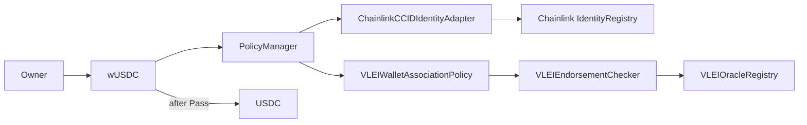

# USDC Compliance Integration

Generated by GL1 Compliance Wizard on 2026-05-06T16:48:52.598Z and extended with a vLEI oracle compliance path.

## Overview

EOA Verifier and vLEI Oracle run as independent services. The
[Oracle-owned local setup](docs/gl1-vlei-local-infra-setup.md) starts them with explicit
peer trust; the [integration scenario](docs/vlei-oracle-e2e.md) verifies witnessed credential
issuance, signed delivery, USDC balance changes and revocation withdrawal.

This Foundry project implements a programmable compliance architecture for the **USDC** (ERC20) token.

## Prototype Maturity

This repository is a production-preparation prototype. It demonstrates the contract boundaries needed for vLEI Legal Entity compliance, but the current oracle path trusts admin/oracle-posted evidence and the local deployment script uses a dev-only `AllowAllPolicyEngine` for Chainlink registry writes. Do not treat the current Anvil deployment profile as production-ready.

Maintainer documentation:

| Document                                                                  | Purpose                                                              |
|---------------------------------------------------------------------------|----------------------------------------------------------------------|
| [Architecture](docs/architecture.md)                                      | Contract responsibilities and transfer evaluation flow               |
| [Identity and vLEI Model](docs/identity-and-vlei-model.md)                | Wallet identity lookup and exact-wallet endorsements       |
| [Oracle Registry](docs/oracle-registry.md)                                | Wallet endorsement fields, authorization, and lifecycle     |
| [GL1 USDC CLI Execution Guide](docs/gl1-vlei-cli-execution-guide.md)      | Human-operated local originator-to-beneficiary workflow              |
| [GL1 USDC Local Infrastructure Setup](docs/gl1-vlei-local-infra-setup.md) | Local service startup, ports, generated artifacts, and cleanup       |
| [Security Model](docs/security-model.md)                                  | Trust boundaries, admin authority, and current limitations |
| [Contracts Reference](docs/contracts-reference.md)                        | Concise contract and interface map                                   |

## Architecture

wUSDC is a noncustodial route for wallet-to-wallet USDC transfers with auditable
compliance decisions. The owner approves the wrapper on USDC and calls
`transfer(to, amount)` or `transferFrom(from, to, amount)`. The explicit-source
variant requires `msg.sender == from`.



The manager resolves each participant's identity from its exact wallet; supplied
identity hints never replace the lookup. The policy checks that each wallet and
resolved identity match its current oracle endorsement. A second wallet for the
same entity requires its own endorsement. `PoliciesRun` records the evaluated
envelope hash and aggregate result; `ComplianceCheckFailed` records policy
rejection. Both direct routes evaluate current state on every call.

Only direct wallet participants are supported. There are no abstract-customer
mediation routes, pending-transfer queues or administrative settlement APIs.
The policy envelope contains the asset, amount, timestamp and wallet parties;
KYC, jurisdiction and VASP enrichment are outside this model. Direct USDC
transfers remain ordinary token transfers; asset-wide enforcement is not a goal.

## Policies

A policy set must be nonempty to pass. An unconfigured manager produces an
audited Fail; neither wrapper route moves tokens or consumes allowance.
Administrators cannot remove the final policy: add its successor before removal.
The local deployment explicitly installs the wallet-association policy.

- **VLEIWalletAssociationPolicy**: policy requiring both originator and beneficiary customer parties to have current exact-wallet endorsements.

## Project Structure

```text
src/
  admin/          AdminControls
  identity/       CCID registry, adapter and their interfaces
  associations/   endorsement registry, checker and registry interface
  policy/         policy manager, wallet policy and policy interfaces
  wrappers/       wUSDC
  demo/           local USDC and AllowAllPolicyEngine
script/           DeployAll composition root
test/
  associations/
  policy/
  integration/    genuine wallet/registry/policy/token scenarios
  support/doubles/
abi/              public ABIs and publication vector
```

## Getting Started

### Prerequisites

- [Foundry](https://book.getfoundry.sh/getting-started/installation) (`foundryup` + `forge`)
- Git and authenticated GitHub CLI (`gh auth login`) for repository access
- A wallet with deployment funds (for testnet/mainnet)

### Clean Checkout Setup

```bash
gh repo clone GLEIF-IT/vlei-comply
cd vlei-comply
./setup.sh
forge build
forge test
```

`setup.sh` initializes the exact submodule revisions recorded in this checkout.
It does not create commits or install moving upstream heads. The equivalent
manual dependency step is `git submodule update --init --recursive`.
Chainlink CCID stubs are tracked in `lib/chainlink-ccid/` and need no download.

### Local deployment

Start Anvil separately, then use a public local Anvil key:

```bash
PRIVATE_KEY='<local Anvil key>' scripts/deploy-local.sh \
  --rpc-url http://127.0.0.1:8545 --output deployments/demo/contracts.json
```

The [deployment command](scripts/README.md) validates the running local chain,
broadcast, deployed code, configured policy and roles before publishing a new
JSON artifact. Python and KERI applications are not required. This local profile
uses the development allow-all registry engine; live-network deployment is a
separate operational concern.

## Compliance Flow

```
Transfer Request
       │
       ▼
┌─────────────────┐
│ wUSDC    │ ◄─── Wrapped transfers only
└─────────────────┘
       │
       ▼
┌─────────────────┐
│  PolicyManager  │ ◄─── AND evaluation
└─────────────────┘
       │
       ▼
┌─────────────────┐
│    Policies     │ ◄─── 1 configured
└─────────────────┘
       │
       ▼
   ✓ Allow / ✗ Deny
```

## Compliance Testing Studio

This project includes a `compliance-spec.json` file that is **required** by the GL1 Compliance Testing Studio.

### About `compliance-spec.json`

This file describes the compliance architecture metadata for your project. It includes:

| Field                 | Description                                      |
|-----------------------|--------------------------------------------------|
| `version`             | Specification version (currently `1.0`)          |
| `compatibility`       | Target VM compatibility (`EVM`)                  |
| `assetStandard`       | Token standard (`ERC20`, `ERC721`, or `ERC1155`) |
| `identityFramework`   | Identity framework used (e.g., `ChainlinkCCI`)   |
| `attestationServices` | List of attestation services with status         |
| `contracts`           | Map of contract roles to filenames               |
| `adminRoles`          | Admin role assignment method                     |

> **⚠️ Warning**: The Compliance Testing Studio will **reject** any ZIP that does not contain this file.

### Preparing for Testing Studio

To use this project with the Testing Studio, compile the contracts first:

```bash
# 1. Follow setup steps above, then:
forge build

# 2. Re-zip the entire folder (including the out/ directory)
cd ..
zip -r vlei-comply-compiled.zip vlei-comply/
```

Then upload the re-zipped file to the Compliance Testing Studio.

### Running Local DevNet (Anvil)

```bash
# Start a local Anvil instance
anvil

# Anvil will provide 10 pre-funded test accounts
# Default RPC URL: http://127.0.0.1:8545
```

### Connecting MetaMask for Sepolia

1. Open MetaMask and switch to the **Sepolia** test network
2. Ensure your wallet has Sepolia ETH (use a faucet if needed)
3. The Testing Studio will prompt MetaMask for wallet connection
4. You will be asked to confirm the **owner** and **complianceAdmin** addresses

### What to Expect During Testing

- **Upload & Validate**: The Testing Studio checks your ZIP for the required structure
- **Deploy**: Contracts are deployed to your selected network
- **Interact**: Mint, transfer, and test compliance enforcement in real time
- **Observe**: Every transaction is logged with gas usage, events, and revert reasons

## Local vLEI demo

Use the [clean-checkout infrastructure guide](docs/gl1-vlei-local-infra-setup.md)
for the Oracle-owned environment and exact dependency selection. Comply owns
only contract build, test and deployment commands.

## Dependencies

| Package                              | Source                                            | Included                         |
|--------------------------------------|---------------------------------------------------|----------------------------------|
| `forge-std`                          | `foundry-rs/forge-std`                            | recorded Git submodules / `setup.sh` |
| `openzeppelin-contracts`             | `OpenZeppelin/openzeppelin-contracts`             | recorded Git submodules / `setup.sh` |
| `openzeppelin-contracts-upgradeable` | `OpenZeppelin/openzeppelin-contracts-upgradeable` | recorded Git submodules / `setup.sh` |
| `chainlink-ccid` (policy-management) | Pre-embedded stub                                 | ✅ Included in `lib/`             |

## License

Apache-2.0

---

Generated by [GL1 Compliance Wizard](https://github.com/gl1-pc-wizard)

See [testing](docs/testing.md) for contract/function lookup and qualification.

Protocol ownership: [Verifier](https://github.com/GLEIF-IT/eoa-verifier/tree/master/protocol)
owns external-association-v1 and shared signed delivery;
[Oracle](https://github.com/GLEIF-IT/vlei-oracle/blob/main/protocol/oracle-api-v1/README.md)
owns receipt/selection/publication; this repository owns its contract interfaces
and [ABI/calldata fixtures](docs/oracle-registry.md). `compliance-spec.json` is
the Testing Studio input. Obsolete generated `manifest.json` has no role in setup
or qualification.

## Naming in code and tests

Name the domain object and distinguish its representation. Use `attestation`
for a `ComplianceAttestation`, `policyStatus` for a `PolicyStatus`,
`deploymentJson` for serialized deployment metadata, and `deployment_path`
for its filesystem destination. Keep the same vocabulary in fixtures and
assertions; state qualifiers supplement the object name rather than replace it.
