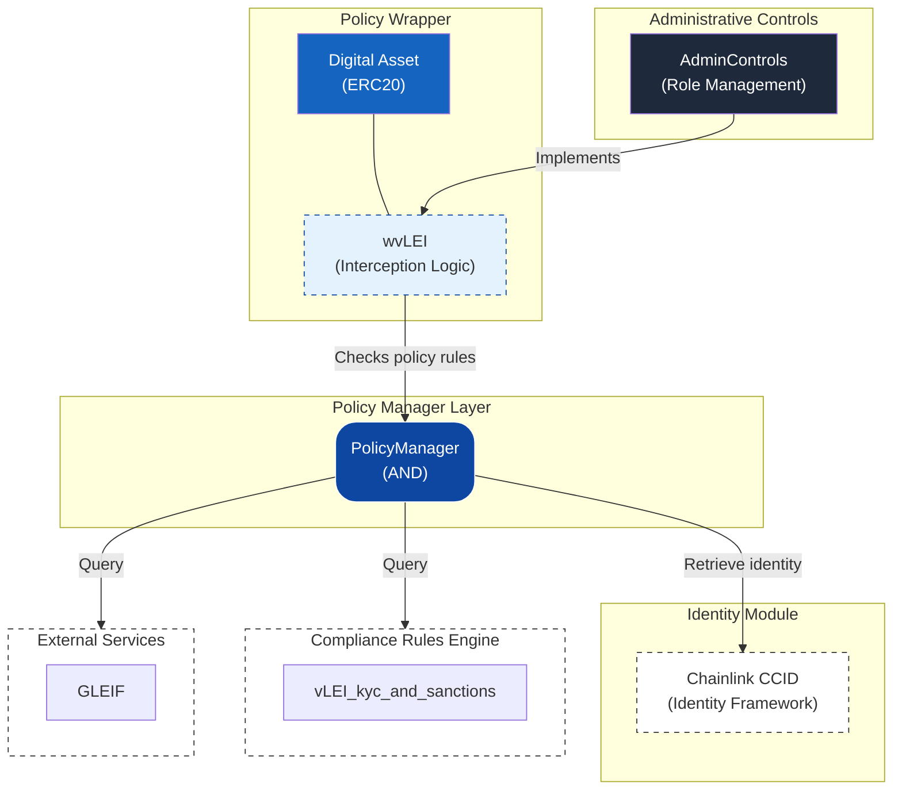

# vLEI Compliance Integration

Generated by GL1 Compliance Wizard on 2026-05-06T16:48:52.598Z

## Overview

This Foundry project implements a programmable compliance architecture for the **vLEI** (ERC20) token.

## Architecture

The compliance framework follows a layered architecture aligned with the reference model (v1.0):



### Component Roles

| Component | Responsibility |
|-----------|----------------|
| **Policy Wrapper** | Intercepts transfers, builds initial `TransactionEnvelope` with minimal context |
| **Policy Manager** | **Orchestration Layer**: Performs dynamic identity enrichment on all parties before policy evaluation |
| **Identity Registry** | **Single Source of Truth**: Provides enriched identity data (KYC, jurisdiction, credentials) |
| **Compliance Rules Engine** | Evaluates policies against the **fully enriched** `TransactionEnvelope` |
| **External Services** | Perform specialized validation using complete enriched `PartyPacket` context |
| **Administrative Controls** | Global system management, role-based access, and emergency pause |

### Dynamic Identity Enrichment Flow

1. **Interception**: The token wrapper (`ERC20`, `ERC721`, or `ERC1155`) catches a transfer and creates a `TransactionEnvelope` containing basic party addresses and amount/TokenID.
2. **Orchestration**: The `PolicyManager` receives the envelope and iterates through every party.
3. **Enrichment**: For each party, the `PolicyManager` queries the `IGL1IdentityRegistry` for all configured identity fields (e.g., `kycHash`, `accountRef`).
4. **Evaluation**: Policies receive the **enriched** envelope, meaning they can immediately check `party.kycHash` or `party.jurisdiction` without making additional external calls.
5. **Attestation**: If a policy requires external validation (e.g., Cleanverse), it passes the enriched `PartyPacket` to the verifier, which has full context of the user's identity status.

## Policies

- **vLEI_kyc_and_sanctions**: vLEI LE, OOR, and ECR credential checks must pass for KYC and sanctions checks

## Project Structure

```
├── src/
│   ├── assets/
│   │   └── vLEI.sol
│   ├── wrappers/
│   │   └── wvLEI.sol
│   ├── policies/
│   │   └── vLEI_kyc_and_sanctions.sol
│   ├── policy/
│   │   └── PolicyManager.sol
│   ├── admin/
│   │   └── AdminControls.sol
│   ├── identity/
│   │   └── [Framework contracts]
│   ├── attestation/
│   │   └── PlaceholderAttestationVerifier.sol
│   └── interfaces/
├── lib/
│   └── chainlink-ccid/   (pre-included)
├── script/
│   └── DeployAll.s.sol
├── test/
├── setup.sh
├── foundry.toml
├── manifest.json
└── README.md
```

## Getting Started

### Prerequisites

- [Foundry](https://book.getfoundry.sh/getting-started/installation) (`foundryup` + `forge`)
- Git
- A wallet with deployment funds (for testnet/mainnet)

### Quick Setup (Recommended)

```bash
# 1. Extract and enter project
unzip vlei-comply.zip
cd vlei-comply

# 2. Run the setup script (initializes git + installs dependencies)
chmod +x setup.sh
./setup.sh

# 3. Build and test
forge build
forge test
```

### Manual Setup

If you prefer to install dependencies manually:

```bash
# 1. Initialize git (required for forge install)
git init && git add -A && git commit -m "initial"

# 2. Install dependencies
forge install foundry-rs/forge-std
forge install OpenZeppelin/openzeppelin-contracts
forge install OpenZeppelin/openzeppelin-contracts-upgradeable

# Note: Chainlink CCID policy-management contracts are pre-included
# in lib/chainlink-ccid/ — no additional install needed.

# 3. Build and test
forge build
forge test
```

### Configuration

Create a `.env` file:

```bash
PRIVATE_KEY=0x...your_private_key
RPC_URL=https://your-rpc-url
```

### Deployment

```bash
# Deploy to local Anvil
anvil &
forge script script/DeployAll.s.sol --rpc-url http://localhost:8545 --broadcast

# Deploy to testnet (e.g., Sepolia)
forge script script/DeployAll.s.sol --rpc-url $RPC_URL --broadcast --verify
```

## Compliance Flow

```
Transfer Request
       │
       ▼
┌─────────────────┐
│ wvLEI    │ ◄─── Wrapped transfers only
└─────────────────┘
       │
       ▼
┌─────────────────┐
│  PolicyManager  │ ◄─── AND evaluation
└─────────────────┘
       │
       ▼
┌─────────────────┐
│    Policies     │ ◄─── 1 configured
└─────────────────┘
       │
       ▼
   ✓ Allow / ✗ Deny
```

## Compliance Testing Studio

This project includes a `compliance-spec.json` file that is **required** by the GL1 Compliance Testing Studio.

### About `compliance-spec.json`

This file describes the compliance architecture metadata for your project. It includes:

| Field | Description |
|-------|-------------|
| `version` | Specification version (currently `1.0`) |
| `compatibility` | Target VM compatibility (`EVM`) |
| `assetStandard` | Token standard (`ERC20`, `ERC721`, or `ERC1155`) |
| `identityFramework` | Identity framework used (e.g., `ChainlinkCCI`) |
| `attestationServices` | List of attestation services with status |
| `contracts` | Map of contract roles to filenames |
| `adminRoles` | Admin role assignment method |

> **⚠️ Warning**: The Compliance Testing Studio will **reject** any ZIP that does not contain this file.

### Preparing for Testing Studio

To use this project with the Testing Studio, compile the contracts first:

```bash
# 1. Follow setup steps above, then:
forge build

# 2. Re-zip the entire folder (including the out/ directory)
cd ..
zip -r vlei-comply-compiled.zip vlei-comply/
```

Then upload the re-zipped file to the Compliance Testing Studio.

### Running Local DevNet (Anvil)

```bash
# Start a local Anvil instance
anvil

# Anvil will provide 10 pre-funded test accounts
# Default RPC URL: http://127.0.0.1:8545
```

### Connecting MetaMask for Sepolia

1. Open MetaMask and switch to the **Sepolia** test network
2. Ensure your wallet has Sepolia ETH (use a faucet if needed)
3. The Testing Studio will prompt MetaMask for wallet connection
4. You will be asked to confirm the **owner** and **complianceAdmin** addresses

### What to Expect During Testing

- **Upload & Validate**: The Testing Studio checks your ZIP for the required structure
- **Deploy**: Contracts are deployed to your selected network
- **Interact**: Mint, transfer, and test compliance enforcement in real time
- **Observe**: Every transaction is logged with gas usage, events, and revert reasons

## Dependencies

| Package | Source | Included |
|---------|--------|----------|
| `forge-std` | `foundry-rs/forge-std` | via `setup.sh` / `forge install` |
| `openzeppelin-contracts` | `OpenZeppelin/openzeppelin-contracts` | via `setup.sh` / `forge install` |
| `openzeppelin-contracts-upgradeable` | `OpenZeppelin/openzeppelin-contracts-upgradeable` | via `setup.sh` / `forge install` |
| `chainlink-ccid` (policy-management) | Pre-embedded stub | ✅ Included in `lib/` |

## License

Apache-2.0

---

Generated by [GL1 Compliance Wizard](https://github.com/gl1-pc-wizard)
