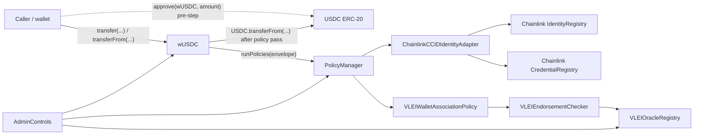

# Architecture

`vlei-comply` is a Foundry prototype for enforcing vLEI Legal Entity compliance around an ERC-20 token wrapper. 
The current implementation is intentionally local-demo friendly, but it uses the same boundaries expected in a production design: 
wrapper enforcement, policy orchestration, identity enrichment, oracle-posted evidence, and fail-closed policy evaluation.

## Contract Flow

The wallet approves `wUSDC` on the USDC contract before settlement. During settlement, the wallet calls `wUSDC`; `wUSDC` calls `USDC.transferFrom` only after policy evaluation returns `Pass`.

## Responsibilities

| Component                      | Responsibility                                                                                                             |
|--------------------------------|----------------------------------------------------------------------------------------------------------------------------|
| `USDC`                         | ERC-20 asset. It enforces only global pause and owner minting. Compliance is not enforced on direct token transfers.       |
| `wUSDC`                        | Transfer-facing enforcement shell. It builds `TransactionEnvelope` values and executes transfers only after policies pass. |
| `PolicyManager`                | Orchestrates policy evaluation and enriches parties through `IGL1IdentityRegistry`.                                        |
| `ChainlinkCCIDIdentityAdapter` | Bridges GL1 policy fields to Chainlink CCID identity and credential registries.                                            |
| `VLEIWalletAssociationPolicy`     | Requires current originator and beneficiary wallet endorsements.                                                             |
| `VLEIEndorsementChecker`      | Checks the exact wallet/entity endorsement and returns a fail-closed boolean.                                                       |
| `VLEIOracleRegistry`           | Stores authorized current wallet/entity/association bindings.                                  |
| `AllowAllPolicyEngine`         | Dev-only policy engine used so Chainlink-style registries can be initialized and written locally.                          |

## Evaluation Semantics

1. The owner initiates `wUSDC.transfer*` after approving the wrapper. There is no global wallet whitelist. Explicit `from` entry points require the caller to be that owner.
2. `wUSDC.transfer*` creates originator and beneficiary `PartyPacket` records.
3. `PolicyManager.runPolicies` resolves `identityRef` from wallet addresses when possible.
4. If a party already has `identityRef`, `PolicyManager` prefers ID-based enrichment for AID-only flows.
5. `VLEIWalletAssociationPolicy` finds the `OriginatorCustomer` and `BeneficiaryCustomer` parties.
6. `VLEIEndorsementChecker` requires nonzero wallet and entity inputs and queries their exact endorsement.
7. A missing, withdrawn, or mismatched endorsement fails. Zero-wallet customer parties fail even with an identity hint.
