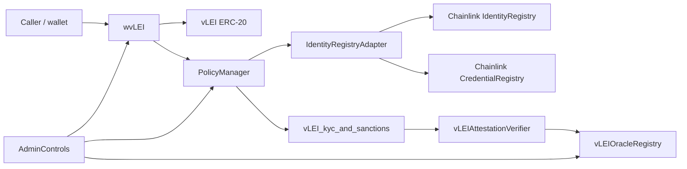

# Architecture

`vlei-comply` is a Foundry prototype for enforcing vLEI Legal Entity compliance around an ERC-20 token wrapper. 
The current implementation is intentionally local-demo friendly, but it uses the same boundaries expected in a production design: 
wrapper enforcement, policy orchestration, identity enrichment, oracle-posted evidence, and fail-closed policy evaluation.

## Contract Flow

## Responsibilities

| Component                 | Responsibility                                                                                                             |
|---------------------------|----------------------------------------------------------------------------------------------------------------------------|
| `vLEI`                    | ERC-20 asset. It enforces only global pause and owner minting. Compliance is not enforced on direct token transfers.       |
| `wvLEI`                   | Transfer-facing enforcement shell. It builds `TransactionEnvelope` values and executes transfers only after policies pass. |
| `PolicyManager`           | Orchestrates policy evaluation and enriches parties through `IGL1IdentityRegistry`.                                        |
| `IdentityRegistryAdapter` | Bridges GL1 policy fields to Chainlink CCID identity and credential registries.                                            |
| `vLEI_kyc_and_sanctions`  | Requires valid originator and beneficiary Legal Entity checks.                                                             |
| `vLEIAttestationVerifier` | Reads oracle-posted vLEI evidence and returns a fail-closed boolean.                                                       |
| `vLEIOracleRegistry`      | Stores admin/oracle-posted AID, LEI, ACDC SAID, expiry, revocation, and allowlist status.                                  |
| `AllowAllPolicyEngine`    | Dev-only policy engine used so Chainlink-style registries can be initialized and written locally.                          |

## Evaluation Semantics

1. `wvLEI.transfer*` creates originator and beneficiary `PartyPacket` records.
2. `PolicyManager.runPolicies` resolves `identityRef` from wallet addresses when possible.
3. If a party already has `identityRef`, `PolicyManager` prefers ID-based enrichment for AID-only flows.
4. `vLEI_kyc_and_sanctions` finds the `OriginatorCustomer` and `BeneficiaryCustomer` parties.
5. `vLEIAttestationVerifier` checks each party's `identityRef` in `vLEIOracleRegistry`.
6. Any missing, expired, revoked, unallowlisted, or LEI-mismatched record fails closed.

