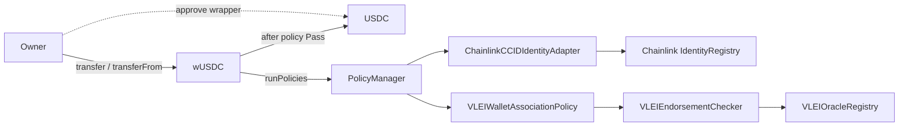

# Architecture

`vlei-comply` is a Foundry prototype for adding auditable compliance decisions to
owner-initiated, wallet-to-wallet USDC transfers through a noncustodial wrapper.
EOA Verifier accepts native credential evidence; oracle publishes its selected
wallet association. Contracts consume current on-chain mappings.

The Chainlink registry and its adapter remain because they supply the exact
wallet-to-entity lookup consumed by `PolicyManager`. The oracle registers that
mapping before publishing the matching endorsement. No credential registry,
trusted-issuer registry or credential-requirement validator is deployed here.

1. The owner approves the wrapper on USDC and initiates a transfer. Explicit
   `from` calls require that owner as caller; allowance grants no third-party
   authority to initiate wrapper transfers.
2. The wrapper creates originator and beneficiary wallet parties.
3. The manager resolves identity from each wallet, replacing supplied hints.
   Missing wallets or failed lookups leave no identity fallback.
4. The association policy requires both roles and their exact current wallet/entity
   endorsements. Revocation, missing mapping or mismatch fails; elapsed time
   does not invalidate an otherwise current endorsement.
5. `PoliciesRun` emits the enriched envelope hash and aggregate result. The wrapper
   emits `ComplianceCheckFailed` for rejection and executes the underlying token
   call only on Pass. Token transfer events establish actual movement.

Pass requires at least one active policy and a Pass from every policy. An empty
set follows the same audit path with Fail and no per-policy results. The wrapper
records a rejection with zero policy ID and does not call the token. The manager
starts unconfigured; deployment must add its intended policy before use.
Administrators replace an only policy by adding its successor before removal.

Both wrapper routes share this path. There is no pending queue, mediated abstract
customer route or administrator settlement path. Shared emergency pause protects
both routes. `AllowAllPolicyEngine` is retained only for local Chainlink registry
initialization/writes; production registry governance remains separate work.
