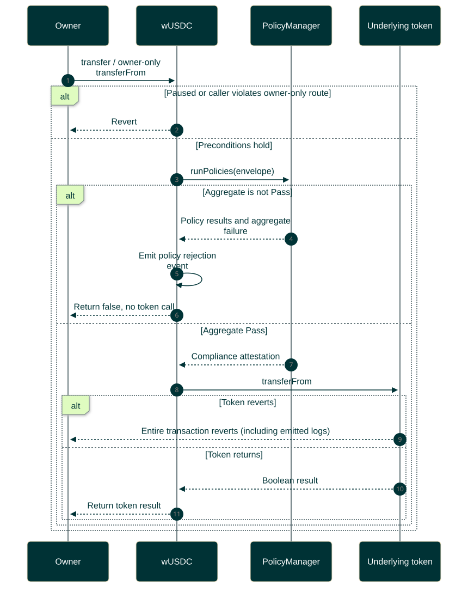
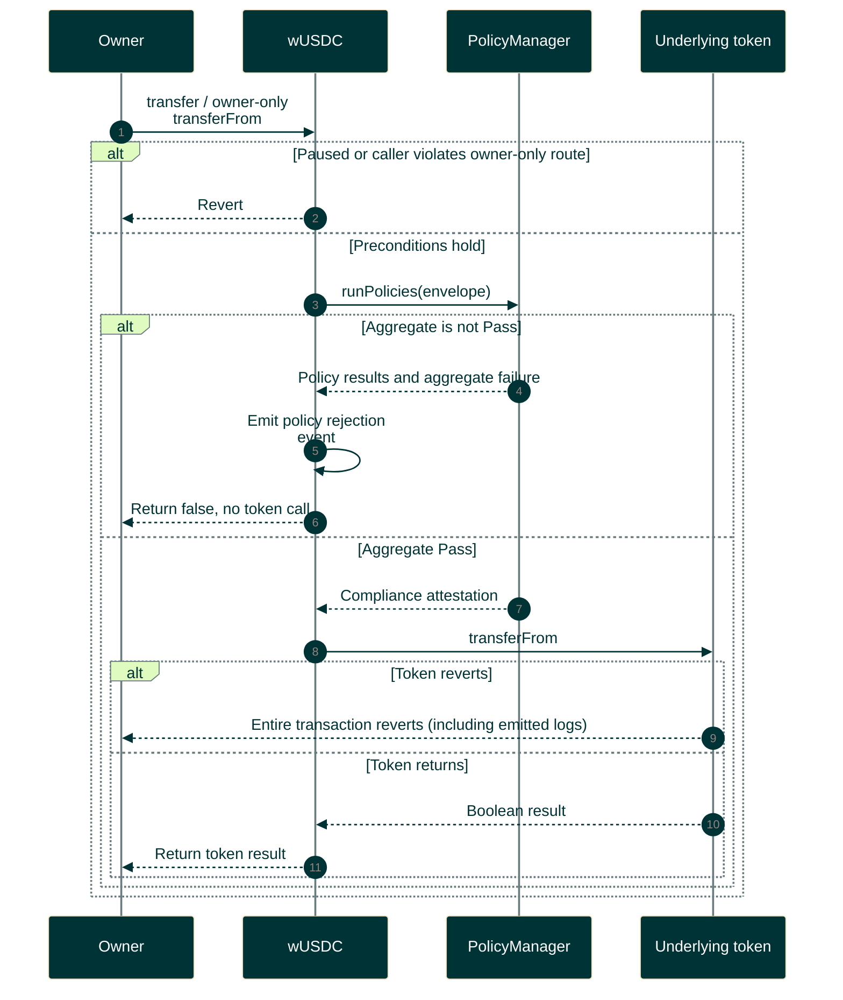

# Transfer rejection and token outcomes

Current wrapper behavior has no queued transfers or administrative settlement.

Editable Mermaid source

A successful transaction receipt can contain policy rejection and zero token movement. Check wrapper result/events and actual balances. Token allowance/balance failures can revert. Prior approvals are separate transactions. Source: [wrapper](../../../src/wrappers/wUSDC.sol).
