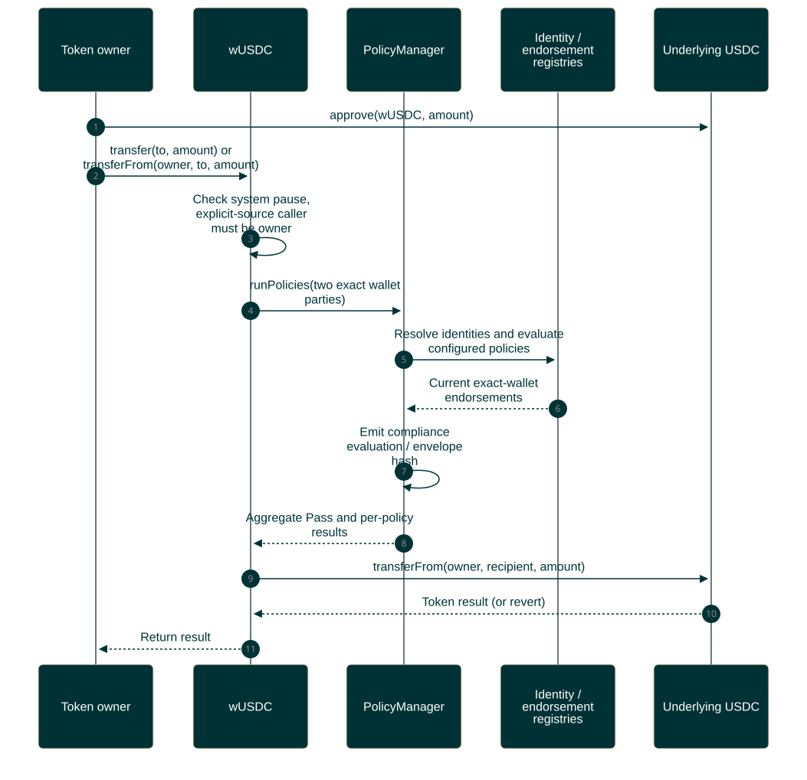
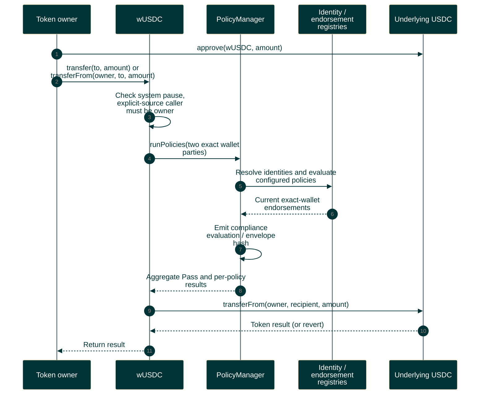

# Direct-wallet compliance transfer

The owner approves wUSDC on the underlying token and invokes transfer or the owner-only transferFrom route.

Editable Mermaid source

See [registry interface](../../oracle-registry.md) and [policy evaluation](wallet-endorsement-evaluation-sequence.md). No wrapped balances are minted. Direct underlying transfers are permitted outside this audit route. An unconfigured manager returns Fail with no per-policy results and records its evaluation hash. The wrapper records rejection with a zero policy ID and makes no token call. The diagram above shows the successful configured-policy path.
