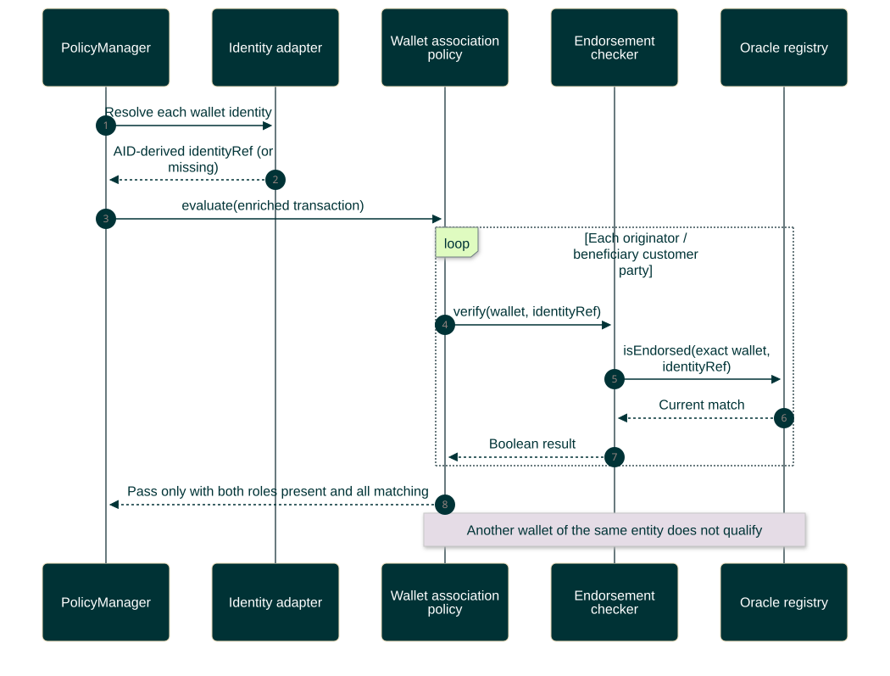
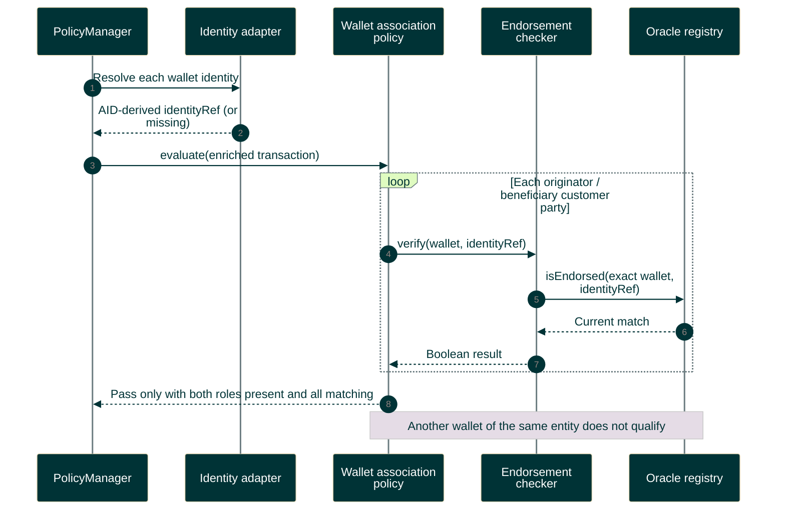

# Exact-wallet endorsement evaluation

The policy checks both originator and beneficiary customer roles. Each needs a wallet and matching entity endorsement.

Editable Mermaid source

This is a read-only check of stored endorsements, not credential verification. See [contract reference](../../contracts-reference.md) and [registry interface](../../oracle-registry.md).
